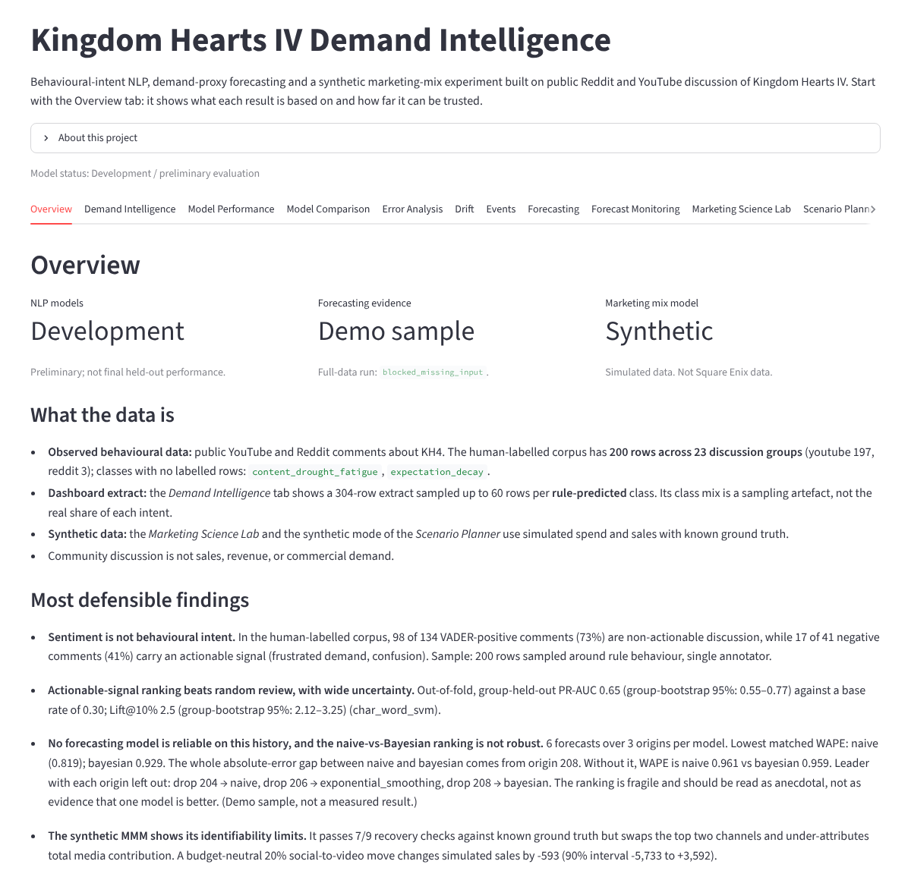

# Behavioural Demand Intelligence, Forecasting & Marketing Science

**Behavioural demand intelligence, Bayesian forecasting and marketing-science
decision support built on public Kingdom Hearts IV community signals, plus a
separately labelled synthetic Marketing Mix Modelling experiment.**

**Live dashboard:** https://kh4-demand-intel.streamlit.app



**Model status: Development / preliminary evaluation** — the labelled
audit corpus is still undergoing expansion and re-audit, so all
supervised-model results are preliminary development benchmarks, not
final held-out performance.

**Key finding:** sentiment is not behavioural intent. Positive comments
can still be low-action lore discussion, while negative or fatigued
comments can reveal demand risk, confusion barriers, or reactivation
opportunities.

**Unofficial portfolio project. Not affiliated with Square Enix, Disney,
or the Kingdom Hearts franchise. Data sourced from public community
discussion.**

---

## Technical highlights

- Supervised behavioural-intent NLP over public Reddit and YouTube discussion
- Calibrated actionable-signal probabilities (validation-only Platt scaling) with group-aware, out-of-fold provenance
- Real timestamp recovery and reproducible weekly temporal aggregation
- Rolling-origin (walk-forward) demand forecasting with explicit leakage tests
- Bayesian forecasting in PyMC, with the likelihood chosen to fit the target
- Forecast bias, interval-calibration and reliability monitoring
- Event-response modelling that is honest about what was knowable when
- Synthetic Bayesian Marketing Mix Model with adstock and saturation
- Posterior scenario simulation for both behavioural and synthetic-marketing questions
- Streamlit analytical application and an optional thin FastAPI service
- CI-tested modular Python throughout

## The central question

> How can public behavioural signals around Kingdom Hearts IV be turned into
> observable demand proxies, forecast over time, monitored for reliability, and
> used alongside a clearly synthetic Marketing Mix Modelling experiment to
> demonstrate marketing decision-support methods?

Five things are kept strictly apart, in code and in every report:

| | What it is |
|---|---|
| 1. Real public data | Reddit and YouTube comments about KH4 |
| 2. Derived demand proxies | Weekly aggregates of that discussion |
| 3. Forecasts | Predictions of those proxies |
| 4. Synthetic marketing data | Simulated spend, price, promotion and sales |
| 5. Model outputs | Estimates, always with their assumptions |

**Community signals are never presented as unit sales.** Kingdom Hearts IV is
unreleased. No Square Enix sales, budgets, ROAS, pricing decisions or campaign
data appear anywhere in this project, and none are inferred.

## Status at a glance

| Component | Data | Status |
|---|---|---|
| Intent NLP | 200 human-labelled public comments, 23 discussion groups, 1 annotator | Development / preliminary |
| Forecasting | 304-row class-stratified **demo sample** | Demo smoke run; full-data run blocked on missing input |
| Marketing mix model | **Synthetic** simulated data with known ground truth | Method demonstration only |

The evidence, its severity-ranked defects and what is blocked are in
[`docs/PORTFOLIO_READINESS_AUDIT.md`](docs/PORTFOLIO_READINESS_AUDIT.md).

## What the evaluation actually found

Ordered from most to least defensible. All numbers regenerate from the files cited.

**1. Sentiment is not behavioural intent.** In the human-labelled corpus, 98 of 134
VADER-positive comments (73%) are non-actionable discussion, while 17 of 41 negative
comments (41%) carry an actionable signal such as frustrated demand or a confusion
barrier. (200 rows sampled around rule behaviour; one annotator.)

**2. Actionable-signal ranking beats random review, with wide uncertainty.** Under
group-aware 5-fold cross-validation (every row scored by a model that never saw its
discussion group; calibration and threshold fitted on inner validation folds), the
word+char SVM reaches Stage 1 PR-AUC 0.65 (group-bootstrap 95%: 0.55–0.77) against a
base rate of 0.30, and Lift@10% 2.5 (2.1–3.3). Intent-level results are weak:
`high_intent` F1 is 0 out of fold, and two classes have no labels at all
(`reports/ml/group_cv_report.md`).

**3. No forecasting model is reliable on this history, and a model ranking based on six
forecasts says almost nothing.** On the demo sample, the naive last-value forecast has
the lowest matched-origin WAPE (0.82 against 0.93 for the hurdle-Gamma Bayesian model).
That comparison is **6 forecasts over 3 origins**, and the sensitivity analysis shows one
origin produces the whole gap: leave it out and the two tie (0.961 vs 0.959). Over all 99
origins, every baseline's WAPE is about 1.0. The value here is the model-selection
discipline: no model was tuned to reverse the ordering, the Bayesian model is not
promoted for being evaluated less, and the report declines to recommend any model
(`reports/demo_forecasting/matched_origin_sensitivity.json`).

The Bayesian model converges cleanly (R-hat about 1.005, zero divergences, bulk ESS in the
thousands), so its loss is not a sampling failure. Its posterior predictive check
reproduces the share of empty weeks but only about half the observed variability, so it
understates spikes. The weekly proxy is sparse (about 64% empty weeks in the sample) with
no seasonal signal, and the event calendar post-dates the observed window, so event
effects are not identifiable.

**4. The synthetic MMM demonstrates identifiability limits, not marketing ROI.** Against
known ground truth it recovers the price, promotion and event directions, diminishing
returns and most adstock decays (7/9 checks), but swaps the top two channels, leaves one
of three true contributions outside its 90% interval, and under-attributes total media
contribution (about 159k against 236k true). A budget-neutral move of 20% of social spend
into video changes simulated sales by −593 (90% interval −5,733 to +3,592): no
detectable effect (`reports/mmm/mmm_report.md`).

**What would change with real commercial data.** The limiting factor is the target, not
the method. With first-party data (units sold, wishlist additions, pre-orders) the same
pipeline would forecast a quantity with a level and a trend, events could be evaluated
against outcomes, and the MMM could be fitted to observed spend. The validation design
would not need to change: it is built to make a weak result visible.

## 1. Problem

Fan discussion volume and sentiment do not reveal *behaviour*: purchase
intent, reactivation, new-player interest, blocked demand, confusion, or
disengagement. This project classifies public community comments into an
eight-class behavioural intent taxonomy, estimates calibrated
actionable-signal probabilities, ranks comments for efficient human
review, and feeds the results into an explainable heuristic scoring
layer and a Streamlit dashboard.

## 2. Dataset

- ~4,831 processed Reddit + YouTube signals (local pipeline output).
- A **200-row manually corrected audit corpus**
  (`reports/audits/intent_audit_corrected.csv`) used as development
  labelled data. Real discussion-group IDs (YouTube video IDs, Reddit
  submission IDs) are recovered deterministically from permalinks —
  23 groups in total.
- Data-quality report: `python -m src.ml.data validate` →
  `reports/data_quality/labelled_data_report.{json,md}`.
- Full documentation: `docs/DATA_CARD.md`.

Two taxonomy classes (`content_drought_fatigue`, `expectation_decay`)
currently have zero labelled rows and cannot be learned or evaluated
until the corpus is expanded.

## 3. Taxonomy

| Intent | Meaning | Actionable |
|------|--------|---|
| high_intent | Explicit purchase intent | ✔ |
| nostalgia_reactivation | Legacy attachment driving re-engagement | ✔ |
| new_customer_interest | Signals from potential new players | ✔ |
| frustrated_demand | Demand blocked by lack of updates | ✔ |
| content_drought_fatigue | Coping signals during content drought | ✔ |
| confusion_barrier | Narrative complexity reducing accessibility | ✔ |
| expectation_decay | Disengagement after prolonged silence | ✔ |
| general_discussion | Non-actionable engagement | ✘ |

Annotation definitions, boundary cases, and priority rules:
`docs/ANNOTATION_GUIDE.md`.

## 4. ML architecture

```
Reddit / YouTube → Ingestion → Preprocessing → VADER Sentiment
        ↓
Behavioural Intent Modelling
    ├── Rule baseline (regex, interpretable)
    ├── TF-IDF Logistic Regression
    ├── TF-IDF Linear SVM
    ├── Word + character TF-IDF SVM
    ├── Optional sentence-embedding model  (.[embeddings])
    └── Optional transformer interface     (.[transformers])
        ↓
Calibrated probabilities (validation-only Platt scaling)
        ↓
Actionable-signal ranking (Precision@K, Recall@K, Lift@K)
        ↓
Heuristic demand / activation / risk scoring (unchanged)
        ↓
Evaluation + error analysis → Streamlit dashboard
        ↓
Temporal aggregation (weekly demand proxies)
        ↓
Forecasting → rolling-origin validation → monitoring → scenarios
```

Separately, and never mixed with the above:

```
Synthetic spend / price / promotion / seasonality  (SYNTHETIC — not Square Enix data)
        ↓
Bayesian MMM (adstock → saturation → contribution)
        ↓
Budget-reallocation scenario simulator
```

The supervised layer (`src/ml/`) is fully separable from the heuristic
scoring layer (`src/score.py`), and the project distinguishes
classification, probability estimation, ranking, and decision-support
scoring. `demand_score` remains an explainable heuristic, not a
forecast.

## 5. Rule baseline

The ordered regex classifier (`src/intent.py`) is retained as the
interpretable baseline, exposed through the common classifier interface
(`src/ml/models.py`). Its fixed 0.7/0.3 outputs are surfaced as a
`rule_confidence_indicator` — never as probabilities. Regression tests
enforce precision floors on the audited corpus: `high_intent` 0.55,
`nostalgia_reactivation` 0.65, `new_customer_interest` 0.70
(`tests/test_intent_audit_regression.py`).

## 6. Supervised models

Benchmark ladder: majority class → rule baseline → TF-IDF Logistic
Regression → TF-IDF Linear SVM → combined word (1–2) + character (3–5)
TF-IDF SVM, with optional sentence-embedding and transformer models
behind extras. The main strategy is **hierarchical**: Stage 1 classifies
actionable vs general, Stage 2 assigns intent among actionable rows; a
flat multiclass benchmark runs alongside for comparison. Class imbalance
is handled with `class_weight="balanced"` and Stage 1 threshold
adjustment (no synthetic augmentation).

## 7. Evaluation methodology

- **Group holdout:** 70/15/15 splits with no discussion group or
  duplicate text crossing splits; automated leakage tests.
- **Validation-only tuning:** calibration and decision thresholds are
  fitted on validation and frozen before the test split is touched.
- **Repeated seeds:** each seed regenerates the split and model
  initialisation; per-seed and mean/std/median outputs are exported.
- **Metrics:** Stage 1 PR-AUC/F1 (prioritised over accuracy), Brier,
  ECE; Stage 2 and end-to-end macro-F1; ranking metrics.

Full rationale: `docs/EXPERIMENT_DESIGN.md`.

## 8. Preliminary results

Two complementary views, both `development_preliminary`:

- **Group-aware cross-validation** (`python -m src.ml.group_cv` →
  `reports/ml/group_cv_report.md`): every row gets an out-of-fold prediction,
  so per-class support is the full corpus count, with group-bootstrap
  intervals, calibration bins with Wilson intervals, per-group stability and
  error slices (source, sampling strategy, length, rule agreement).
- **Repeated group holdout** (`python -m src.ml.benchmark`), below.

> **Preliminary development benchmark** — 200 rows, 23 groups, 5 seeds.
> Generated tables: `reports/ml/results_summary.csv`,
> `reports/ml/model_comparison.md`. Numbers are not hardcoded here
> because they regenerate with every benchmark run; on this tiny corpus
> the rule baseline still leads end-to-end macro-F1 while SVM-family
> models lead Stage 1 actionable ranking. Seed variance is large — the
> corpus must be expanded before any number is treated as meaningful.

## 9. Ranking / decision-support metrics

For actionable-signal review efficiency the benchmark reports
Precision@K, Recall@K, and Lift@K (K = 10/25/50/100 and 5/10/20%), plus
cumulative-gains and lift curves (`reports/ml/figures/`). Lift@10%
answers: how many more actionable signals does a reviewer find in the
top 10% model-ranked comments than by random review? Only measured lift
is reported.

## 10. Error analysis

`python -m src.ml.error_analysis` exports false positives, false
negatives, most-confident errors, multiclass errors, and rule-vs-model
disagreements (`reports/ml/tables/`), with Markdown summaries
(`reports/ml/error_analysis.md`, `reports/ml/rule_model_comparison.md`).
Qualitative error categories are a human-review template, never
auto-assigned. An active-learning queue
(`python -m src.ml.active_learning`) prioritises the most informative
rows for the next annotation pass.

## 11. Dashboard

```bash
pip install -e .[ml,app]
streamlit run app.py
```

Tabs: **Overview** (status, data provenance, the most defensible findings with
their uncertainty, blocked work and links to evidence, all read from generated
artefacts), **Demand Intelligence** (the 304-row class-stratified extract, with
a banner saying so), **Model
Performance**, **Model Comparison**, **Error Analysis**, **Drift**,
**Events**, **Forecasting**, **Forecast Monitoring**, **Marketing Science
Lab**, **Scenario Planner**, and **Live Inference**. The app shows the
current model status, renders generated report artefacts rather than
fitting models at page load, and degrades gracefully when report files are
absent.


## 12. Temporal foundations and demand proxies

Signal timestamps are the creation time supplied by the source API, parsed to
timezone-aware UTC in one place (`src/timestamps.py`) with an explicit report of
what was valid, missing or invalid. Scrape time is never substituted for
creation time, and a missing timestamp stays missing rather than being invented.

`src/temporal.py` aggregates scored signals into complete weekly periods. The
headline column is the **behavioural demand proxy**:

```
actionable_probability_mass_t = sum over comments i observed in t of P(actionable_i)
```

This is an **expected actionable-signal volume** derived from the supervised
classifier's calibrated probabilities. It is **not** expected purchases, revenue
or units. Probabilities for rows in the labelled corpus are computed
**out-of-fold** with group-aware folds, so no row is scored by a model that saw
its own discussion group, and every row records its `probability_source`. The
rule baseline's 0.7/0.3 confidence indicator is never used as a probability.

Empty weeks keep zero counts but undefined rates: a week with no comments
observed nothing about a rate, and recording 0% would invent an observation.

## 13. Forecasting

Validation is **rolling-origin only**; random splits are never used. Two leakage
properties are covered by tests: future values cannot change an earlier origin's
forecast, and event features are gated on `announced_date`, so an event that had
not been publicly announced at a forecast origin contributes nothing there.

Simple baselines (naive, trailing mean, seasonal naive, exponential smoothing,
ridge on lags plus event features) remain eligible to win. Model complexity
follows a coverage audit of the actual history rather than assumption.

The Bayesian likelihood follows the target: a **hurdle** model (Bernoulli for
whether a week is non-zero, Gamma for its level) for the continuous demand
proxy, which is legitimately zero in quiet weeks and is never rounded; Negative
Binomial for integer counts; Binomial **on the underlying counts** for rates.

Metrics are MAE, RMSE, WAPE, signed bias, interval coverage and width, with MASE
only where valid. Ordinary MAPE is deliberately absent because zero weeks make
it unstable. Model selection uses WAPE first but demotes a leader that shows
persistent directional bias or badly calibrated intervals.

Monitoring tracks rolling error, signed bias and interval hits across origins,
and flags persistent over- or under-forecasting at configurable thresholds.

Full methodology: `docs/FORECASTING.md`.

## 14. Synthetic marketing science lab

**SYNTHETIC MARKETING SCIENCE DEMONSTRATION. This is not Square Enix data.**

Kingdom Hearts IV is unreleased, so no media spend, pricing, promotion or sales
data exists for it. Rather than invent figures, `src/mmm/` simulates a weekly
marketing dataset from an explicit process and records the true parameters
beside it. That is what makes it checkable: the model is scored on whether it
recovers the process that generated the data.

Geometric adstock, Hill saturation, a Bayesian MMM in PyMC, posterior channel
contributions with credible intervals, price and promotion effects, and a
budget-reallocation scenario simulator. On the committed run the model recovers
the price, promotion and event directions, but **swaps the top two channels**,
leaves one of three true contributions outside its 90% interval, and
under-attributes total media contribution — genuine identifiability limitations
that are reported rather than tuned away. Reallocation scenarios are
budget-neutral (spend moves between channels; the total is unchanged).

Synthetic data lives only in `data/synthetic/` and `reports/mmm/`, every row
carries `data_type = synthetic`, and the fitter refuses non-synthetic input.

Full details: `docs/MMM_LAB.md`.

## 15. Analytical interfaces

The Streamlit app gains **Forecasting**, **Forecast Monitoring**, **Marketing
Science Lab** and **Scenario Planner** tabs. The scenario planner separates
`REAL BEHAVIOURAL SCENARIO` from `SYNTHETIC MARKETING SCENARIO` explicitly.

An optional thin FastAPI service exposes the same service layer:

```bash
pip install -e .[api]
uvicorn src.api:app --reload
```

| Endpoint | Purpose |
|---|---|
| `GET /health` | Which generated artefacts are available |
| `GET /forecast/summary` | Headline forecasting results and bias flags |
| `POST /forecast/scenario` | Behavioural demand scenario |
| `POST /mmm/scenario` | Synthetic marketing scenario |

Handlers contain no business logic; both interfaces call `src/services.py`, so
they cannot answer differently. Neither fits a model at request time.

## 16. Reproducing the temporal and marketing work

```bash
pip install -e .[ml,app,dev,forecast,api]

# Everything, over the full local dataset
python scripts/run_temporal_pipeline.py --input data/processed/signals_scored.csv --save-posterior

# Or step by step
python scripts/build_temporal_dataset.py --input data/processed/signals_scored.csv
python scripts/run_forecasting.py --save-posterior
python scripts/run_mmm.py --save-posterior
```

Before a full run, check what is missing (exits 2 and lists exact commands
when the canonical data is absent; nothing is substituted):

```bash
python scripts/check_full_data_readiness.py
```

The committed results under `reports/demo_forecasting/` come from the
class-stratified 304-row portfolio extract, which is **not volume-representative**.
They are stamped `sample_only = true`, `volume_representative = false` and
`evaluation_status = demo_only`, and exist only to show the pipeline runs. A
committed demo extract passed without `--demo` is refused (matched by path and
content hash), so it can never be stamped as the full dataset. Every run also
writes `matched_origin_sensitivity.json` (per-origin and leave-one-origin-out
WAPE) so a ranking decided by one origin is visible.
`reports/forecasting/` is reserved for a run over the full canonical dataset.

Optional, network-dependent: recover creation timestamps for rows collected
before they were handled correctly.

```bash
python -m src.enrich_timestamps --input data/processed/signals_clean.csv --output data/processed/signals_clean.csv
```

## 17. Reproducibility

### Ingesting YouTube comments

Comment data is not committed (see `.gitignore`); regenerate it from the
video seed list. Requires `YOUTUBE_API_KEY` in `.env`.

```bash
cp data/raw/youtube/video_seed_list.example.csv data/raw/youtube/video_seed_list.csv
# edit the seed list to taste; only the video_id column is required

python -m src.scraper_youtube --seed-list --max-results 100
```

This fetches comments for every listed video into
`data/raw/youtube/youtube_comments_<video_id>.csv` and writes a provenance
record to `reports/tables/youtube_fetch_manifest.csv`. Videos that already
have an output CSV are skipped so re-runs do not burn API quota — pass
`--force` to re-fetch, and `--fetch-metadata` to also record each video's
real title and channel (the seed list's own `title`/`channel` columns are
hand-written and unverified). A single unavailable video is recorded as
`failed` in the manifest without aborting the batch; the command exits
non-zero if any video failed.

Single-video mode is unchanged:

```bash
python -m src.scraper_youtube --video-id <YT_VIDEO_ID> --max-results 100
```

Then run the analysis pipeline:

```bash
python scripts/run_pipeline.py    # preprocess → sentiment → intent → score → events
```

### Model reproducibility

```bash
pip install -e .[ml,dev]

python -m src.ml.data validate                 # data-quality report
python -m src.ml.dataset_audit                 # support, near-duplicates, annotation revision
python -m src.ml.group_cv                      # group-aware CV with bootstrap CIs
python -m src.ml.benchmark \
  --models majority rules logistic linear_svm char_word_svm \
  --seeds 42 43 44 45 46                       # full benchmark
python -m src.ml.train --model logistic        # persist artefacts
python -m src.ml.error_analysis                # error reports
python -m src.ml.drift                         # distribution-shift report
python -m src.ml.active_learning               # re-audit queue
python -m src.ml.annotation_queue build        # stratified, blind expansion queue
pytest                                         # full test suite
```

Every run records run ID, git commit, dataset hash, annotation version,
seeds, split/group counts, frozen threshold, and
`evaluation_status = development_preliminary`
(`reports/ml/run_metadata.json`).

## 18. Limitations

- 200 labelled rows across 23 discussion groups: split variance
  dominates; all supervised results are preliminary.
- Two taxonomy classes have no labelled examples; three more have fewer than ten.
- One annotator. First-pass and final labels agree on 57% of rows (κ 0.30),
  a revision rate rather than inter-annotator agreement, which is unmeasured.
- 197/200 labelled rows are YouTube; Reddit performance is unmeasured.
- Labels were sampled around rule-classifier behaviour (selection bias).
- `demand_score` is a heuristic decision-support signal, not a forecast.
- Community signals are not unit sales; KH4 is unreleased, so no purchase
  conversion exists to validate any forecast against.
- Comment volume is platform-dependent and reflects what was collected and how
  platform algorithms surfaced it, not total public interest.
- Event coefficients are associations, not causal effects.
- Forecast uncertainty grows with horizon; long-range forecasts on this history
  are weak.
- The committed forecasting results are a demo smoke run over a stratified
  sample and are not volume-representative; the matched-origin model ranking
  rests on 6 forecasts and is decided by a single origin.
- The marketing mix model is fitted to synthetic data; its channel
  contributions are only partially identified even there.
- See `docs/MODEL_CARD.md` and `docs/DATA_CARD.md`.

## 19. Roadmap

1. Re-audit existing labels via `reports/annotation/review_queue.csv`
   using `docs/ANNOTATION_GUIDE.md`.
2. Expand the labelled corpus with the stratified, blind queue
   (`python -m src.ml.annotation_queue build`, rebuilt on the canonical pool),
   with a double-annotated overlap for inter-annotator agreement; QC with
   `python -m src.ml.annotation_queue validate`.
3. Run the forecasting pipeline over the full local dataset and publish the
   measured results to `reports/forecasting/`.
4. Freeze a final test set; re-run the benchmark with
   `evaluation_status = final_held_out`.
5. Populate the gated CV metrics in `reports/portfolio_summary.md`.
6. Evaluate the optional embedding/transformer models on the expanded
   corpus.

---

**Author:** Ghobikan Aravindan
