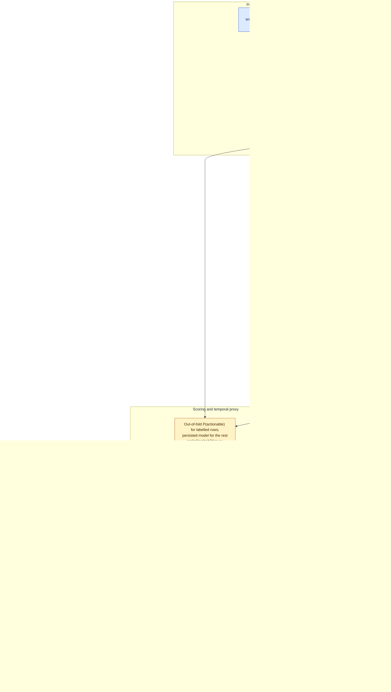

# Architecture

Four kinds of data move through this system, and the diagram keeps them visually apart:
**observed public discussion** (blue), **derived behavioural demand proxies** (green),
**forecasts and model outputs** (amber), and **synthetic marketing data** (grey). The
synthetic lane shares no inputs with the observed lanes; they meet only in the interface
layer, where every synthetic view is labelled as simulated. Nothing here is sales data, and
discussion volume is never presented as sales.

## Data-type boundaries enforced in code

| Boundary | Where it is enforced |
|---|---|
| A demo extract is never stamped as the full dataset | `src/temporal.py::is_known_demo_extract` (path and content hash) |
| Labelled rows are never scored in-sample for the proxy | `src/ml/probabilities.py` (`oof_supervised` / `excluded_training_row`) |
| The rule 0.7/0.3 indicator is never a probability | `src/ml/models.py` score types; Platt-calibrated only on validation |
| The MMM fitter refuses observed data | `src/mmm/model.py` raises when `data_type` is present and not `synthetic` (a frame with no `data_type` column is not checked) |
| Scenarios use only samples from the run they describe | `src/posterior_store.py` (run-ID stamp checked by `src/services.py`) |
| Model outputs never become labels | `src/ml/annotation_queue.py` (blind file), `src/ml/adjudication.py` |

## Batch versus interactive paths

| Path | Command | Model | Notes |
|---|---|---|---|
| Batch scoring | `python -m src.ml.batch_inference --input X.csv --output Y.csv` | persisted or trained-on-demand logistic | writes `Y.monitoring.json` |
| Weekly proxy | `python scripts/build_temporal_dataset.py` | same, out of fold for labelled rows | provenance per row |
| Interactive | dashboard *Live Inference*, `src.ml.inference.predict_text` | same; trained once per process if no artefact | rule fallback only if training is impossible |
